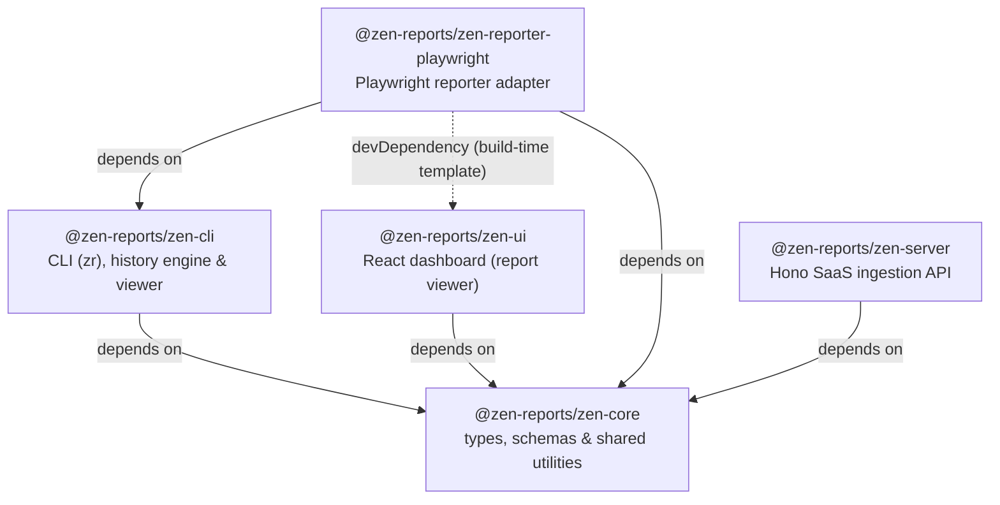
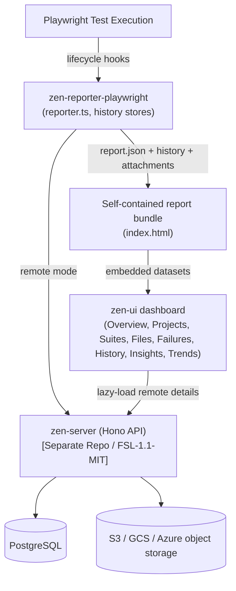

# Project Structure & Architecture

Zen Reporter is a **multi-package monorepo** (npm workspaces). The root `package.json` (`zen-reports-monorepo`) owns the workspaces config, shared
lint/test/format scripts, and the Playwright test configuration. All runtime code lives under `packages/`.

```text
zen-reports/
├── package.json               # Monorepo root (npm workspaces: packages/*)
├── playwright.config.ts       # Playwright config for the repo's own test suite
├── tests/                     # Playwright specs for Zen Reporter itself
├── zen-report/                # Generated self-contained report bundle output
└── packages/
    ├── core/                  # @zen-reports/zen-core                → see [core](packages/core.md)
    ├── cli/                   # @zen-reports/zen-cli                 → see [cli](packages/cli.md)
    ├── ui/                    # @zen-reports/zen-ui                  → see [ui](packages/ui.md)
    └── reporter-playwright/   # @zen-reports/zen-reporter-playwright → see [reporter](packages/reporter-playwright.md)
```

---

## Package Dependency Graph



### About zen-server

[`zen-server`](https://github.com/zen-reports/zen-server) is maintained as a separate standalone repository at [GitHub](https://github.com/zen-reports/zen-server).

> **Important — License Distinction**:
> While `zen-reports` (including `@zen-reports/zen-core`, `@zen-reports/zen-cli`, `@zen-reports/zen-ui`, and `@zen-reports/zen-reporter-playwright`) is licensed under the permissive **MIT License**, `zen-server` is licensed under the restrictive **Functional Source License, Version 1.1, MIT Future License ([FSL-1.1-MIT](https://github.com/zen-reports/zen-server/blob/main/LICENSE))**.
> Under FSL-1.1-MIT, use of `zen-server` for competing commercial products or services is prohibited until the change date (2 years after publication), after which it converts to MIT. Internal use, non-commercial education, and non-commercial research are permitted.

### Package Overview

| Package                                | Role                                                                                                                           | Depends on                                                      | Built with                  |
| :------------------------------------- | :----------------------------------------------------------------------------------------------------------------------------- | :-------------------------------------------------------------- | :-------------------------- |
| `@zen-reports/zen-core`                | Shared domain types, report/history schemas, and pure utility functions (CSV export, formatting, stats, theming, highlighting) | —                                                               | `tsc` (ESM + CJS dual emit) |
| `@zen-reports/zen-cli`                 | CLI commands (`zr`, `zen-reporter`), history querying & persistence (SQLite/DuckDB), report serving, and system diagnostics    | `zen-core`                                                      | `vite` + `tsc`              |
| `@zen-reports/zen-ui`                  | Interactive HTML report dashboard; single-file Vite/React bundle with all UI tabs                                              | `zen-core`                                                      | `vite`                      |
| `@zen-reports/zen-reporter-playwright` | Playwright reporter lifecycle, report bundle generation, and test execution data processing                                    | `zen-core`, `zen-cli` (runtime); `zen-ui` (build-time template) | `vite` + `tsc`              |

> **Note:** `zen-reporter-playwright` consumes the built UI bundle as a build-time asset:
> `zen-ui` is declared as a devDependency, and `build:template`
> (`scripts/copy-template.mjs`) copies `index.html` + `favicon-*.svg` from the
> resolved `zen-ui` package into the reporter's `dist/`.
> Build order: `core → cli → ui → reporter:playwright`
> (root script: `npm run build`).

---

## High-Level Data Flow



- **Local mode:** the reporter writes `report.json`, SQLite `history.db`, and
  attachment files next to the generated `index.html`. The UI renders from
  datasets inlined into that single HTML file. See [reporter](packages/reporter-playwright.md).
- **Remote mode:** `RemoteHistoryStore` (in the reporter) uploads attachments
  directly to cloud storage via presigned URLs and streams run metadata to the
  server. The UI lazily fetches heavy test details from the server. See
  [`zen-server`](https://github.com/zen-reports/zen-server) and [reporter](packages/reporter-playwright.md).

---

## Detailed Package Documentation

- [`packages/core.md`](packages/core.md) — shared types, schemas & utilities
- [`packages/cli.md`](packages/cli.md) — CLI terminal interface, history engine & report viewer
- [`packages/ui.md`](packages/ui.md) — dashboard architecture, tabs & components
- [`packages/reporter-playwright.md`](packages/reporter-playwright.md) — reporter lifecycle, bundle generation & data flow
- [`zen-server`](https://github.com/zen-reports/zen-server) — backend API, storage & REST reference (standalone repository)
