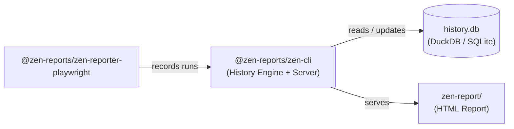

# `@zen-reports/zen-cli` — Terminal Interface, History Engine & Report Viewer

`@zen-reports/zen-cli` provides the standalone terminal dashboard, command-line interface (`zr` and `zen-reporter`), DuckDB/SQLite local history querying engine, and static HTTP viewer for Zen Reporter.

---

## Role in the Architecture



`@zen-reports/zen-cli` acts as the runner-agnostic management and serving layer:

- **CLI Binaries**: Provides `zr` and `zen-reporter` globally or locally via `npx`.
- **History Storage**: Contains `SqliteHistoryStore` (DuckDB embedded queries) and `RemoteHistoryStore` (Zen Server sync).
- **Report Serving**: Serves the generated static HTML report via `zr show`.
- **Diagnostics & Data**: Provides `zr env`, `zr summary`, `zr history query`, and CSV exports.

---

## Installation

Typically installed as a direct dependency of reporter packages (such as `@zen-reports/zen-reporter-playwright`), or installed explicitly for standalone report viewing:

```bash
npm install @zen-reports/zen-cli
```

---

## Commands

See [CLI Documentation](../cli.md) for full usage and command syntax.

```bash
# Serve generated report
npx zr show

# Inspect historical trends and runs
npx zr history
npx zr history flaky
npx zr history slow
npx zr history trends
npx zr history trends duration

# Output Markdown summary snippet
npx zr summary
```
